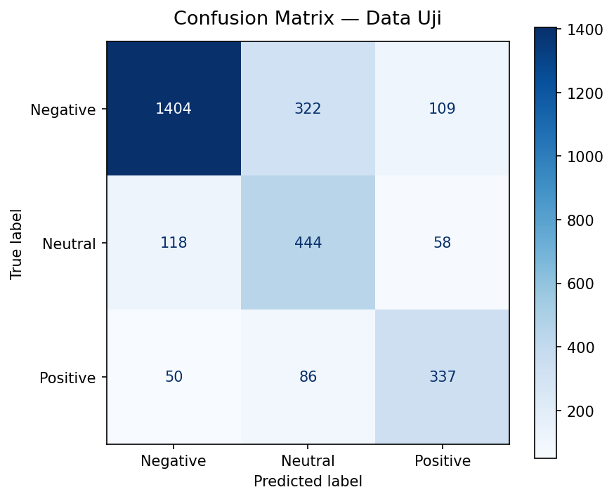

# ✈️ Social Media Sentiment Analysis — Multi-Class NLP Classification

End-to-end Natural Language Processing (NLP) project untuk mengklasifikasikan sentimen opini pelanggan penerbangan di media sosial (Twitter/X) ke dalam 3 kategori: **Negative**, **Neutral**, dan **Positive**, menggunakan representasi **TF-IDF n-grams** dan **Logistic Regression (Class-Weighted)**, dilengkapi analisis kata kunci (*explainability*) serta aplikasi web interaktif berbasis Streamlit.

[](https://www.python.org/)
[](https://scikit-learn.org/)
[](https://streamlit.io/)

---

## 📌 Ringkasan Proyek

Di era digital, media sosial menjadi saluran utama pelanggan menyampaikan keluhan, pertanyaan, dan apresiasi. Bagi industri penerbangan dan layanan publik, deteksi sentimen otomatis secara real-time sangat penting untuk memprioritaskan eskalasi komplain darurat (*delay*, bagasi hilang) serta memonitor kepuasan pelanggan secara objektif.

Proyek ini menggunakan dataset **Twitter US Airline Sentiment** dari Kaggle yang mencakup 14.640 data tweet nyata. Pendekatan yang diterapkan mencakup pembersihan teks media sosial (*regex pipeline*), ekstraksi fitur unigram dan bigram dengan TF-IDF, penanganan ketimpangan kelas (*class imbalance*), serta evaluasi komprehensif berbasis **Macro F1-Score**.

### 🏆 Highlight Hasil Akhir (Holdout Test Set — 2.928 Tweet):
- **Model Terbaik:** **TF-IDF + Logistic Regression (Class-Weighted Balanced, $C=0.5$)**
- **Macro F1-Score:** **`0,7058`** (Menyeimbangkan akurasi di seluruh kelas tanpa bias mayoritas)
- **Akurasi Keseluruhan:** **`74,62%`**
- **Deteksi Komplain Negatif:** **Precision `89,31%`** dan **F1-Score `0,8242`** (sangat minim alarm palsu)
- **Deteksi Kepuasan Positif:** **Recall `71,25%`** dan **F1-Score `0,6899`**

---

## 📊 Temuan Kunci EDA & Analisis Data

1. **Ketimpangan Kelas Sentimen (*Class Imbalance*):**
   - **Negative:** 9.178 tweet (**62,69%**)
   - **Neutral:** 3.099 tweet (**21,17%**)
   - **Positive:** 2.363 tweet (**16,14%**)
   - Dominasi sentimen negatif merupakan karakteristik alami media sosial (pelanggan jauh lebih vokal saat mengalami kendala penerbangan).
2. **Karakteristik Maskapai:**
   - **United, US Airways, dan American** mencatatkan volume komplain negatif tertinggi.
   - **Virgin America dan Delta** memiliki proporsi sentimen netral dan positif yang lebih tinggi dan seimbang.

---

## 🧹 Pipeline Pembersihan Teks (*Regex Text Preprocessing*)

Sebelum vektorisasi, teks media sosial dibersihkan secara sistematis:
- **Case Folding:** Normalisasi seluruh huruf ke *lowercase*.
- **Hapus @mentions & #hashtags:** Menghapus nama akun `@airline` agar model tidak bias pada entitas spesifik.
- **Hapus URL & Link Web:** Menghapus tautan `http://...` atau `https://...`.
- **Hapus Entitas HTML:** Membersihkan karakter seperti `&amp;`, `&lt;`, `&gt;`.
- **Hapus Tanda Baca & Angka:** Mempertahankan hanya karakter alfabet a–z.

---

## ⚙️ Evaluasi & Perbandingan Model (5-Fold Stratified CV)

Seluruh pemrosesan TF-IDF dan estimasi bobot model dievaluasi menggunakan **5-Fold Stratified Cross-Validation** pada data latih (11.712 tweet):

| Arsitektur Model | Macro F1-Score | Accuracy | Weighted F1 | Karakteristik Performa |
| :--- | :---: | :---: | :---: | :--- |
| **Dummy Classifier (Baseline)** | 0,2569 | 62,70% | 48,32% | Selalu menebak kelas mayoritas (Negative) |
| **Multinomial Naive Bayes** | 0,6107 | 73,99% | 70,42% | Cenderung bias ke kelas mayoritas |
| **Linear SVM (LinearSVC Balanced)** | 0,6838 | 74,62% | 74,74% | Kuat memisahkan bidang hiperteks |
| **Logistic Regression (Balanced, C=0.5)** | **`0,7031`** 🏆 | **`74,68%`** 🏆 | **`75,45%`** 🏆 | **Model Terbaik!** Seimbang di seluruh kelas & menyediakan estimasi probabilitas |

---

## 📈 Evaluasi Holdout Test Set & Confusion Matrix

Model final diuji pada 2.928 tweet independen:

| Kategori Sentimen | Precision | Recall | F1-Score | Support (Jumlah Data Uji) |
| :--- | :---: | :---: | :---: | :---: |
| **Negative** | **89,31%** | 76,51% | **0,8242** | 1.835 |
| **Neutral** | 52,11% | **71,61%** | 0,6033 | 620 |
| **Positive** | 66,87% | **71,25%** | 0,6899 | 473 |
| **Rata-rata Makro (*Macro Avg*)** | **69,43%** | **73,12%** | **0,7058** | **2.928** |



> **Insight Matriks Konfusi:** Model hampir tidak pernah membalikkan polaritas secara fatal (hanya 50 dari 1.835 tweet negatif yang keliru diprediksi positif). Sebagian besar kesalahan klasifikasi terjadi di perbatasan kelas netral.

---

## 💡 Kata Kunci Paling Berpengaruh (*Model Explainability*)

Koefisien bobot model Logistic Regression memperlihatkan kata-kata yang paling memicu klasifikasi:

- **Top Indikator Negatif:** `'hours'`, `'hold'`, `'delayed'`, `'worst'`, `'cancelled'`, `'luggage'`, `'bag'`, `'terrible'`.
- **Top Indikator Netral:** `'hi'`, `'chance'`, `'need'`, `'dm'`, `'tomorrow'`, `'possible'`, `'does'`.
- **Top Indikator Positif:** `'thanks'`, `'thank'`, `'great'`, `'awesome'`, `'love'`, `'best'`, `'amazing'`, `'appreciate'`.

---

## 🚀 Menjalankan Aplikasi Web (Streamlit)

Aplikasi menyediakan antarmuka analisis sentimen interaktif dengan visualisasi probabilitas keyakinan real-time:

```bash
# 1. Clone repositori
git clone https://github.com/rafikamindra98/airline-sentiment-analysis.git
cd airline-sentiment-analysis

# 2. Buat dan aktifkan virtual environment
python -m venv .venv
source .venv/bin/activate  # macOS/Linux
# atau di Windows PowerShell: .venv\Scripts\Activate.ps1

# 3. Pasang dependensi & jalankan
pip install -r requirements.txt
streamlit run app.py
```

Buka peramban pada `http://localhost:8501`.

---

## 📁 Struktur Repositori

```text
airline-sentiment-analysis/
├── app.py                         # Aplikasi web analisis sentimen Streamlit
├── sentiment_artifacts/           # Model terlatih & artefak evaluasi
│   ├── sentiment_model.joblib     # Pipeline TF-IDF + Logistic Regression
│   ├── metadata.json              # Rekaman parameter & versi dependensi
│   ├── confusion_matrix.png       # Grafik confusion matrix data uji
│   └── test_results.csv           # Rekap metrik data uji
├── data/
│   └── README.md                  # Petunjuk dataset sumber (Kaggle)
├── notebooks/
│   └── 03_sentiment_analysis.ipynb # Notebook lengkap eksperimen NLP
├── reports/figures/
│   └── confusion_matrix.png
├── requirements.txt               # Dependensi runtime Streamlit
├── requirements-notebook.txt      # Dependensi analisis notebook
├── .gitignore
└── README.md
```

---

## 👤 Penulis
**Rafi Kamindra**  
- GitHub: [@rafikamindra98](https://github.com/rafikamindra98)
